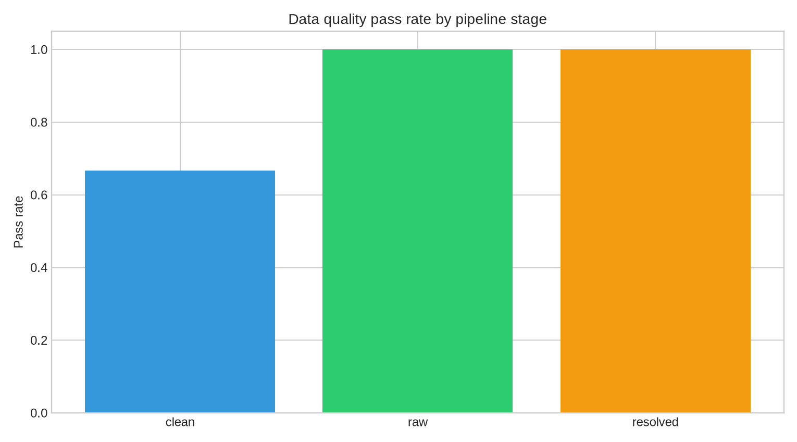
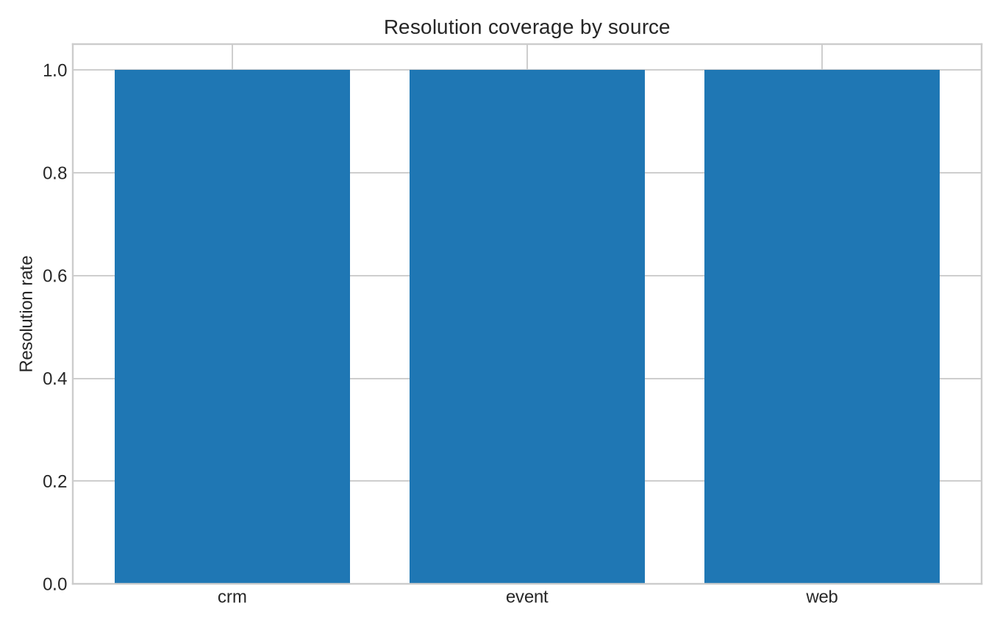

# B2B Identity Resolution & Data Quality Pipeline

## Problem

**Resolve fragmented professional signals into unique, reliable identities.** This repository is a compact, reproducible demonstration of ingestion, normalization, blocking, fuzzy matching, classification, analytical SQL and end-to-end data quality.

No real personal data is used. Company metadata is sourced from the public French [API Recherche d’Entreprises](https://recherche-entreprises.api.gouv.fr/docs/). Contacts, emails, phones and profile URLs are synthetic and generated locally.

## Architecture



```text
Public company API + synthetic contacts → Python ingestion → MinIO/S3 raw
                                      → normalize / block / match
                                      → PostgreSQL operational tables
                                      → ClickHouse analytics → Metabase
                                      → quality results and product questions
```

PostgreSQL is used for operational upserts and constraints. ClickHouse is used for columnar analytical scans and aggregations. MinIO makes the object-storage boundary reproducible locally.

## Results

The demo contains **20 public company records**, **120 synthetic contacts**, **375 fragmented signals** from CRM, web and event sources, and **120 resolved identities**. On the synthetic truth set, precision, recall and F1 are all **1.00**. The quality pipeline runs **8 controls**, with **7 passing** and one visible review condition caused by blank domains in event signals.



The score is deliberately evaluated against generated truth. It demonstrates the mechanics of the pipeline, not production performance on unknown data.

## How to run

```bash
docker compose up -d
make ingest
make quality
make test
```

The current demo can also run without Docker: `python3 build_project.py`. Docker services are provided for PostgreSQL, ClickHouse, MinIO and Metabase integration.

## Pipeline choices

Normalization lowercases emails, removes `www.` from domains, strips URL query parameters, standardizes phones, removes accents and legal-form tokens, and keeps source provenance. Blocking compares only records that share a domain or first-name initial. This avoids all-to-all comparison and is the main performance safeguard at scale.

Matching combines exact email, profile URL and phone evidence with RapidFuzz similarities for first name, last name and company. A logistic-regression classifier is trained on synthetic positive and negative pairs because the generator provides ground truth. Each output includes a resolved person ID and confidence score.

The quality layer checks freshness, volume, email validity, key uniqueness, company-domain completeness, matching precision, resolution coverage and confidence completeness. Results are stored in `quality/dq_results.csv` and `quality/dq_results.json`.

## Product questions

`sql/business_questions.sql` answers the share of high-confidence profiles by source, the weakest domain coverage, freshness by source and the size of the review queue. PostgreSQL and ClickHouse DDL are in `sql/postgres/` and `sql/clickhouse/`.

## Limitations

The contacts are synthetic, the matching truth is generated, and the public company API is a search API rather than a full SIRENE dump. A production deployment would add secured credentials, Parquet partitioning in object storage, a real incremental watermark, human review feedback, calibrated probabilities, privacy retention rules and benchmark timings on representative volumes.

## Repository map

`data/raw/` contains public company metadata and synthetic signal sources. `data/clean/` contains normalized signals. `data/resolved/` contains identity links, coverage and metrics. `quality/` contains historized controls. `dashboard/` contains static quality views. `docs/` explains architecture, controls and performance. `docker-compose.yml` provides the local service boundary.
